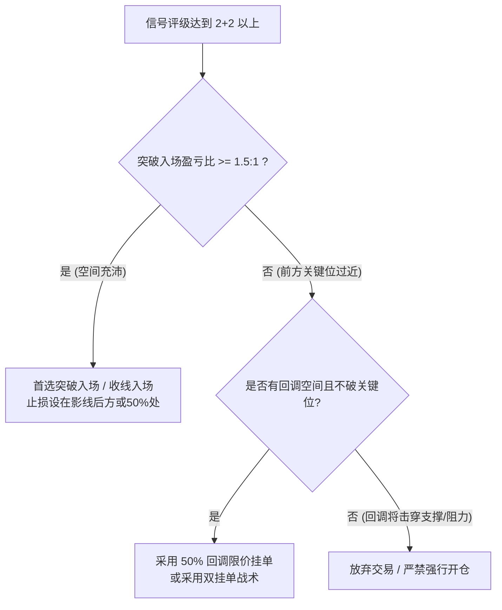

# 五大入场与止损策略矩阵

信号评级达到 $2+2$ 及以上后，必须结合盈利空间、关键位相对位置与止损承受力，从以下策略矩阵中匹配最佳入场与止损方案。

---

## 1. 基础入场与止损模型

### (1) 突破入场 (Breakout Entry)
- **入场方式**：挂突破单（Buy Stop / Sell Stop）。看涨时等待价格突破信号K线最高价；看跌时等待价格跌破信号K线最低价。
- **优缺点**：最稳健、确认度最高。信号被突破才算正式成立。缺点是面临整根信号K线高度的止损，点数较大。
- **止损方案**：
  - **方案A（经典全影线止损）**：止损设在信号极值影线后方 $3 \sim 5$ 个点（最安全保底）。
  - **方案B（50%压缩止损）**：止损设在信号自身高度的 $50\%$ 回调位置。若行情突破信号后再度折返超过 $50\%$，信号本身已大概率失效，此法可将止损点数减半，提升盈亏比。

### (2) 收线入场 (Close Entry)
- **入场方式**：当观察到K线即将收盘且形态已固定符合标准时，在收盘瞬间以市价入场。
- **适用场景**：4小时及日线图表（日线周二至周五优选，周一需防周末跳空）。
- **止损方案**：价格反向刺穿信号极值影线外侧。

### (3) 回调入场 (Retracement Entry)
- **入场方式**：挂限价单（Buy Limit / Sell Limit），等待价格向信号影线内部进行深幅回测时进场。
- **回调档位分类**：
  - **$33.3\% - 38.2\%$ 回调**：浅度回调，兼顾成交率与盈亏比提升。
  - **$50.0\%$ 回调**：实战最核心档位。止损距离压缩 $50\%$，允许开仓量翻倍，盈亏比极高。
  - **$61.8\% - 66.7\%$ 回调**：深度回调。止损距离极小，但若价格回调至此，反转为真突破打掉止损的风险极高，仅在关键位刚好位于该位置时使用。
- **止损方案**：统一设置在信号极值影线外侧。

---

## 2. 进阶高级战术矩阵

### (4) 双挂单战术（兼顾策略）
用于解决“等回调容易踏空，破位追止损又过大”的两难境地：
- **挂单一（突破单）**：突破信号最高/最低点进场，止损设在信号的 **$50\%$ 压缩位**。
- **挂单二（回调单）**：挂在信号的 **$50\%$ 回调位**限价进场，止损设在信号的 **极值影线后方**。
- **盯盘联动规则**：只要其中一笔订单被触发成交，**立刻手动撤销另一笔挂单**。既不错过单边急速行情，又能在震荡回踩时拿到极佳点位。

### (5) 斐波那契分批建仓法 (Scaled Entry)
用于应对信号实体或影线过大、单笔一次性进场止损超出承受上限的极端行情：
- **资金切分**：将计划仓位（例如 10手）按 **2手 + 3手 + 5手**（或 5手 + 5手）阶梯式拆分。
- **布局点位**：
  - 第1笔（底仓）：在信号回调至 $38.2\%$ 或 $50\%$ 时建仓，止损设在影线后方。
  - 第2笔（加仓）：在价格重回突破信号极值时追加入场，止损统一跟随设在影线后方。
- **风控红线**：若回调直接击穿影线，仅亏损小额底仓；若直接突破，仅执行突破仓位，整体平均风险远低于一次性重仓进场。

---

## 3. 入场策略快速决策树

