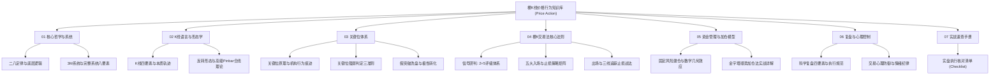

# 裸K线交易法 (Price Action) 知识库系统

本知识库基于许佳聪著《裸K线交易法：价格行为(Price Action)全面详解》进行系统性蒸馏构建。
剔除所有冗余叙述，提取出核心交易哲学、形态几何公理、关键位体系、2+5信号评级、出入场策略矩阵、金字塔加仓风控模型及情绪纪律。

---

## 知识库架构总览

---

## 知识库模块目录与文件索引

### 模块一：核心哲学与交易系统
- [01_二八定律与交易底层逻辑.md](file:///Users/pengjieqing/Desktop/裸k线交易法/knowledge_base/01_核心哲学与交易系统/01_二八定律与交易底层逻辑.md)
  - 市场的二八分布法则、散户亏损的五大致命病灶、交易思维的重构。
- [02_3M系统与完整交易系统八要素.md](file:///Users/pengjieqing/Desktop/裸k线交易法/knowledge_base/01_核心哲学与交易系统/02_3M系统与完整交易系统八要素.md)
  - Mind/Money/Market权重架构、客观交易系统八大要素（标的、仓位、方向、入场、止损、止盈、对策、后手）、入场点优化的数学几何倍增公式。

### 模块二：K线语言与形态学
- [01_K线四要素与本质轨迹.md](file:///Users/pengjieqing/Desktop/裸k线交易法/knowledge_base/02_K线语言与形态学/01_K线四要素与本质轨迹.md)
  - 四大基准价位（OHLC）、常见单根/双根/三根K线动能剖析、K线跨周期合成原理、M头与W底的K线等价转化。
- [02_反转形态与高级Pinbar合线理论.md](file:///Users/pengjieqing/Desktop/裸k线交易法/knowledge_base/02_K线语言与形态学/02_反转形态与高级Pinbar合线理论.md)
  - Pinbar严格技术定义（主影线超2/3）、市场说谎机制（匹诺曹的鼻子）、面孔与左右眼系统、吞没与双星形态的高级Pinbar合线定理、多线合线数量平衡原则。

### 模块三：关键位体系（最重要基石）
- [01_关键位原理与机构行为痕迹.md](file:///Users/pengjieqing/Desktop/裸k线交易法/knowledge_base/03_关键位体系/01_关键位原理与机构行为痕迹.md)
  - 散户 vs 机构行为学、机构大资金的盘面物理痕迹（大阴大阳线与拐点）、水平关键位核心地位。
- [02_关键位强弱判定三准则.md](file:///Users/pengjieqing/Desktop/裸k线交易法/knowledge_base/03_关键位体系/02_关键位强弱判定三准则.md)
  - 强关键位三准则（拐点级别大、离现价近、触碰次数多）、辅助关键位（跳空缺口、整数关口、斐波那契黄金分割位）。
- [03_假突破洗盘与极性转化.md](file:///Users/pengjieqing/Desktop/裸k线交易法/knowledge_base/03_关键位体系/03_假突破洗盘与极性转化.md)
  - 极性转化原则（支撑阻力互换）、假突破的微观流动性掠夺本质、假突破识别与防套牢规范。

### 模块四：裸K交易法核心法则 (Price Action)
- [01_信号研判_2加5评级体系.md](file:///Users/pengjieqing/Desktop/裸k线交易法/knowledge_base/04_裸K交易法则_Price_Action/01_信号研判_2加5评级体系.md)
  - 2个基本门槛条件（强关键位 + 明确波段高低位）、5个细节加分项（盘面显眼度、假突破、左眼包容与幅度、顺大趋势、盈亏比 $\ge 1.5:1$）、$2+2$ 准入硬指标。
- [02_五大入场与止损策略矩阵.md](file:///Users/pengjieqing/Desktop/裸k线交易法/knowledge_base/04_裸K交易法则_Price_Action/02_五大入场与止损策略矩阵.md)
  - 突破入场、收线入场、回调入场（38.2%、50%、61.8%）、双挂单战术、斐波那契分批建仓法、入场策略决策树。
- [03_出场与三线追踪止损战法.md](file:///Users/pengjieqing/Desktop/裸k线交易法/knowledge_base/04_裸K交易法则_Price_Action/03_出场与三线追踪止损战法.md)
  - 目标关键位让利原则、三线战法（最新3根K线极值追踪止损）、单向锁定利润法则。

### 模块五：资金管理与加仓模型
- [01_固定风险建仓与数学几何效应.md](file:///Users/pengjieqing/Desktop/裸k线交易法/knowledge_base/05_资金管理与加仓模型/01_固定风险建仓与数学几何效应.md)
  - 固定风险金手数反算公式、心理锚定假说、盈亏比与胜率数学期望矩阵（1.5:1盈亏比下只需40%胜率）。
- [02_金字塔顺势加仓法实战详解.md](file:///Users/pengjieqing/Desktop/裸k线交易法/knowledge_base/05_资金管理与加仓模型/02_金字塔顺势加仓法实战详解.md)
  - 顺势加仓 vs 逆势扛单摊薄、移动止损无本金风险加仓机制、加仓仓位严谨数学反演、经典80倍盈亏比案例全复盘。

### 模块六：复盘与心理控制
- [01_科学复盘四要素与执行规范.md](file:///Users/pengjieqing/Desktop/裸k线交易法/knowledge_base/06_复盘与心理控制/01_科学复盘四要素与执行规范.md)
  - 复盘四要素（信号审查、入场与止损合理性、主动与被动走势、周期匹配）、良性亏损与恶性盈利的界定、双周期看盘机制。
- [02_交易心理防御与情绪纪律.md](file:///Users/pengjieqing/Desktop/裸k线交易法/knowledge_base/06_复盘与心理控制/02_交易心理防御与情绪纪律.md)
  - 克服贪婪、恐惧、频繁交易、报复式交易、缺乏耐心五大心理杀手；日内亏损熔断规则、离开屏幕的智慧。

### 模块七：实战速查手册
- [裸K线交易法规则清单_Checklist.md](file:///Users/pengjieqing/Desktop/裸k线交易法/knowledge_base/07_实战速查手册/裸K线交易法规则清单_Checklist.md)
  - 盘前一票否决项核查、2+5星级速查计算、入场风控手数即时核算、持仓出场纪律自检表。
